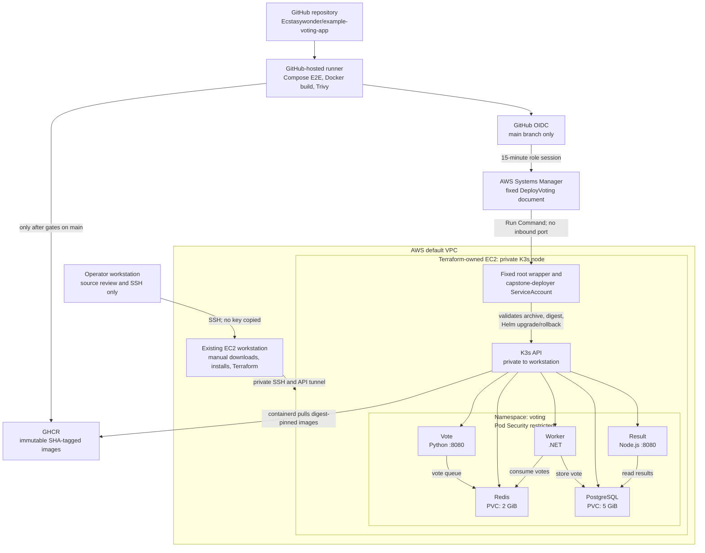

# Capstone 1 architecture

This diagram is source-controlled architecture documentation. It represents
the private single-node K3s design selected for the course's lowest-cost
Kubernetes requirement. The GitHub-to-SSM path was exercised successfully in
[the recorded deployment run](../evidence/automatic-deployment.md).

## Network and data paths

The cluster security group permits SSH from the course operator and the
workstation, and K3s API port `6443` only from the workstation's private IP.
It exposes no application ingress. `vote` and `result` are reached through an
authorized Kubernetes port-forward. The chart's NetworkPolicies deny
release-wide ingress by default, then allow namespace-local HTTP access and
only the required Vote/Worker-to-Redis and Result/Worker-to-PostgreSQL paths.

Redis and PostgreSQL use `Recreate` Deployments with retained local-path PVCs.
The `voting-db` Secret is created on the node and provides a PostgreSQL
administrator password for initialization and a separate least-privilege
`voting_app` password to Result and Worker. The chart never creates or stores
the password values.

## Release and trust path

The CI workflow runs the Compose E2E suite first. It then builds `linux/amd64`
Vote, Result, and Worker images and fails on Trivy HIGH or CRITICAL findings.
For the canonical repository's `main` branch, a publication job pushes the
same scanned image to GHCR and records its manifest digest. A deployment job
validates all three handoff manifests before assuming a GitHub OIDC role
restricted to that repository and branch.

The role can send only the named SSM document to the tagged K3s node. The
document accepts tightly validated commit and digest parameters and invokes a
fixed root-owned program, rather than receiving a workflow-provided shell
command. The program creates a short-lived namespace ServiceAccount token,
downloads and structurally validates the public source archive, applies the
single Helm chart with digest overrides, runs the application E2E test, and
rolls back to the prior Helm revision when that post-deploy test fails.

The `capstone-deployer` role is limited to the `voting` namespace. It has no
Kubernetes permission for nodes, namespaces, persistent volumes, RBAC,
ServiceAccounts, or TokenRequest. Because Helm release state and `voting-db`
are Secrets in that namespace, trusted repository writers remain a meaningful
namespace-secret trust boundary. The workflow and host boundary documentation
describe that residual risk and the production hardening still needed.

## Manual rollback proof

The manual Helm demonstration uses a deliberately nonexistent immutable Result
digest to create an observable failed revision, then rolls back to the recorded
healthy revision. It verifies that both PVC UIDs remain unchanged and reruns
the application E2E test. Exact commands and safety notes are in
[docs/helm.md](../helm.md).
